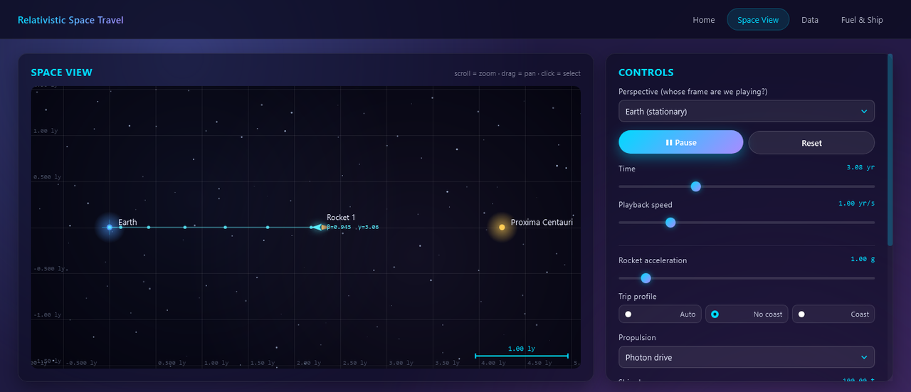
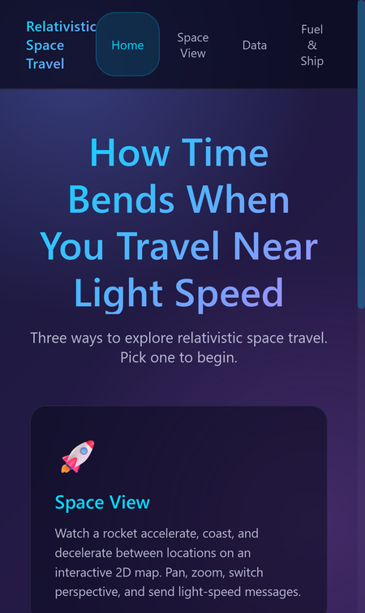
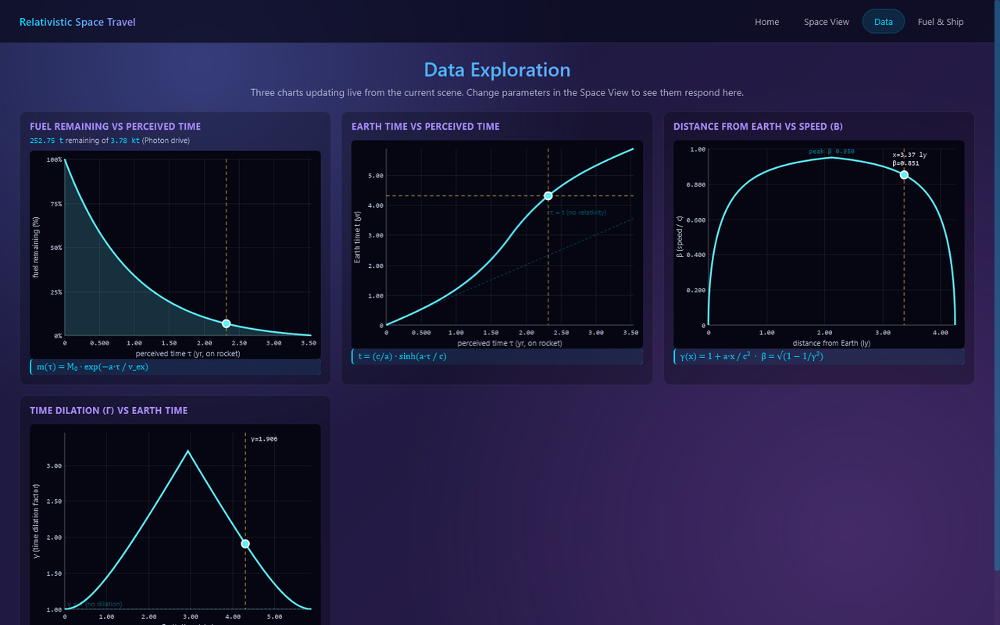
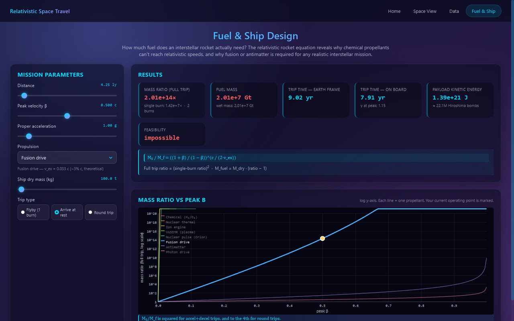

# Relativistic Space Travel

A space-travel simulator that shows how time bends when a rocket flies near the speed of light: watch the trip on a star map, see the physics on live graphs, and work out how much fuel it would really take.

**[▶ Open the live app](https://timothyhadfield.github.io/space-travel/)** · works on phone and laptop

  
  &nbsp;
  

  
  

## Features
- **Space View** — a rocket accelerates, coasts and brakes between Earth and Proxima Centauri on a 2D star map. Play, pause, scrub time, change playback speed, zoom and pan.
- **Switch perspective** — play the trip from Earth's frame or the rocket's, and watch the clocks disagree.
- **Build your own scene** — add locations, add more rockets, and send light-speed messages between them.
- **Trip settings** — rocket acceleration in g, "no coast", "coast" at a cruise speed, or "auto", plus propulsion type and ship dry mass.
- **Live data graphs** — fuel left vs ship time, Earth time vs ship time, speed vs distance, and γ vs Earth time, each with its equation.
- **Fuel & ship design** — pick a distance, top speed, acceleration and one of eight propellants (chemical to photon drive) to get the mass ratio, fuel mass, trip times and a feasibility verdict, for a flyby, a stop, or a round trip.
- **The math is written down** — every equation used is in [physics_reference.md](physics_reference.md).

## Built with
Vanilla JavaScript, HTML canvas and CSS. No libraries, no build step.
